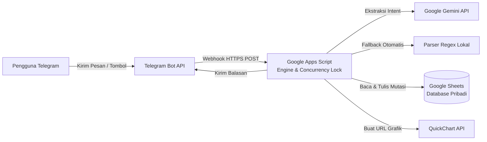

# LedgerFlow (Dompet Palsu Bot)

Bot Telegram untuk pembukuan keuangan multi-akun pribadi berbasis Google Apps Script dan Google Spreadsheet, terintegrasi dengan Google Gemini AI untuk pemrosesan teks alami.

Proyek ini dirancang untuk mereka yang ingin mencatat arus kas harian langsung dari ruang percakapan Telegram tanpa bergantung pada aplikasi pihak ketiga berbayar. Seluruh data transaksi, konfigurasi anggaran, dan histori saldo tersimpan di Google Drive milik pengguna sendiri.

---

## Masalah yang Diselesaikan

Mencatat pengeluaran harian sering kali terhambat oleh antarmuka aplikasi yang lambat, kewajiban menghubungkan rekening bank pribadi ke peladen luar, atau biaya langganan bulanan.

LedgerFlow mengambil pendekatan mandiri:
- Data berada penuh di akun Google Spreadsheet pribadi. Tidak ada basis data pihak ketiga yang mengumpulkan informasi finansial Anda.
- Tanpa biaya infrastruktur. Berjalan langsung di atas Google Apps Script dengan kuota bawaan akun Google.
- Input transaksi fleksibel. Pengguna dapat mengetik perintah ringkas dalam bahasa percakapan sehari-hari.
- Perhitungan saldo berbasis riwayat mutasi, bukan angka statis yang ditimpa manual.

---

## Logika Pencatatan dan Fitur Utama

### 1. Perhitungan Saldo Tercatat
Saldo setiap akun dihitung menggunakan rumus riwayat mutasi aktif sejak titik awal saldo ditetapkan:

Saldo Akhir = Saldo Awal + Pemasukan - Pengeluaran + Transfer Masuk - Transfer Keluar +/- Penyesuaian

Jika terjadi pembatalan transaksi melalui `/undo` atau perubahan nominal melalui `/edit`, sistem menghitung ulang saldo akun secara otomatis.

### 2. Multi-Akun dan Deteksi Biaya Admin
Sistem mengenali berbagai rekening bank dan dompet digital (Tunai, BCA, Mandiri, BRI, BNI, BSI, Jago, SeaBank, GoPay, OVO, ShopeePay, DANA). 

Ketika mencatat transfer antar-akun yang memuat biaya administrasi (contoh: "Transfer BCA ke GoPay 100rb + admin 2500"), sistem secara otomatis membaginya menjadi dua catatan:
1. Transaksi transfer pokok sebesar 100.000 (mengurangi BCA, menambah GoPay).
2. Transaksi pengeluaran biaya admin sebesar 2.500 (pos pengeluaran Biaya Admin pada akun BCA).

### 3. Konfirmasi Akun Ambigu dan Peringatan Saldo Kurang
- Jika pengguna mencatat pengeluaran tanpa menyebutkan akun dan belum mengatur akun baku, bot akan menanyakan akun yang digunakan melalui tombol interaktif.
- Jika nominal pengeluaran melebihi saldo tercatat pada akun terkait, bot akan memberikan peringatan dan meminta konfirmasi sebelum saldo tercatat menjadi minus.

### 4. Koreksi Saldo Fisik (Audit Trail)
Jika uang fisik atau mutasi riil berbeda dengan catatan (misal karena lupa mencatat jajan kecil), pengguna cukup mengetik "Saldo tunai sebenarnya 420rb karena lupa catat parkir". Bot akan menghitung selisih dan mencatatnya sebagai transaksi Penyesuaian tanpa menghapus riwayat sebelumnya.

### 5. Rekap Harian dan Evaluasi Bulanan
- Perintah `/rekap` menyajikan ringkasan pengeluaran hari ini terhadap target anggaran harian.
- Perintah `/bulan` menyusun analisis bulanan lengkap dengan grafik garis tren harian dan diagram proporsi kategori belanja menggunakan integrasi QuickChart API.

---

## Alur Sistem



---

## Struktur Tabel Google Spreadsheet

Sistem membutuhkan empat lembar kerja pada Google Spreadsheet:

| Nama Sheet | Fungsi | Kolom yang Digunakan |
| :--- | :--- | :--- |
| Users | Menyimpan profil dan batas anggaran pengguna | Chat ID, Username, Nama, Daily Budget, Persona, Created At, Default Akun |
| Akun | Menyimpan daftar rekening/dompet dan titik saldo awal | Chat ID, Nama Akun, Saldo Awal, Tanggal Mulai Saldo, Updated At, Catatan |
| Transaksi | Buku besar utama pencatatan seluruh mutasi | ID Transaksi, Timestamp, Chat ID, Tipe, Akun, Akun Tujuan, Nominal, Kategori, Item, Alasan, Pesan Asli, Status, User |
| Pengeluaran | Sinkronisasi khusus untuk kebutuhan grafik dan rekap | TimeStamp, Chat ID, Nominal, Kategori, Chat Asli, Chat Asli User, User, ID Transaksi, Akun, Status |

---

## Panduan Pemasangan

### Langkah 1: Persiapan Lembar Kerja
1. Buat berkas spreadsheet baru di Google Sheets.
2. Buat empat tab sheet dengan nama persis: `Users`, `Akun`, `Transaksi`, dan `Pengeluaran`.

### Langkah 2: Pemasangan Skrip
1. Buka menu spreadsheet, pilih **Ekstensi** lalu klik **Apps Script**.
2. Salin seluruh isi berkas `script.js` pada repositori ini ke dalam editor kode.
3. Buka **Project Settings** (ikon gerigi), centang opsi **Show "appsscript.json" manifest file in editor**.
4. Salin konfigurasi dari berkas `appsscript.json` ke editor manifest.

### Langkah 3: Pengaturan Kredensial
Buka **Project Settings** > **Script Properties**, lalu tambahkan properti berikut:

| Properti | Keterangan | Wajib / Opsional |
| :--- | :--- | :--- |
| BOT_TOKEN | Token otentikasi bot dari Telegram @BotFather | Wajib |
| GEMINI_API_KEY | Kunci akses API dari Google AI Studio | Opsional (Sangat disarankan) |
| WEBAPP_URL | URL hasil deployment Web App (didapat pada Langkah 4) | Wajib |
| SPREADSHEET_ID | ID unik spreadsheet (antara /d/ dan /edit pada URL sheet) | Wajib jika skrip dibuat standalone |

Catatan: Tersedia juga fungsi bantuan `setupScriptProperties()` di dalam `script.js` untuk mengisi properti di atas langsung melalui eksekusi kode.

### Langkah 4: Publikasi Web App
1. Klik tombol **Deploy** di sudut kanan atas, lalu pilih **New deployment**.
2. Pilih jenis deployment **Web app**.
3. Atur konfigurasi:
   - **Execute as**: Me (alamat email Anda).
   - **Who has access**: Anyone.
4. Klik **Deploy** dan setujui izin akses akun Google yang diminta.
5. Salin URL Web App yang muncul, lalu simpan ke Script Property dengan nama `WEBAPP_URL`.

### Langkah 5: Registrasi Webhook dan Pemicu Otomatis
1. Pada menu fungsi di editor Apps Script, pilih fungsi `setWebhook` lalu jalankan (Run). Periksa log untuk memastikan balasan Telegram menyatakan status berhasil (`ok: true`).
2. Pilih fungsi `pasangTriggerBulanan` lalu jalankan (Run) agar rekapitulasi bulanan dikirim otomatis setiap tanggal 1 pagi.

---

## Daftar Perintah dan Pola Pesan

### Perintah Garis Miring

| Perintah | Penjelasan | Contoh Penggunaan |
| :--- | :--- | :--- |
| `/start` | Membuka panduan awal dan profil anggaran pengguna | `/start` |
| `/saldo` | Memeriksa rincian saldo tercatat tiap akun beserta totalnya | `/saldo` |
| `/setakun` | Menentukan akun pembayaran default agar tidak perlu diketik berulang | `/setakun Tunai` atau `/setakun reset` |
| `/undo` | Membatalkan transaksi aktif terakhir atau transaksi berdasarkan ID | `/undo` atau `/undo TRX-2611221015-123` |
| `/edit` | Mengubah nilai nominal pada transaksi terakhir | `/edit 35rb` atau `/edit 35rb pakai BCA` |
| `/setbudget` | Menetapkan target pagu anggaran pengeluaran per hari | `/setbudget 150k` |
| `/setpersona` | Mengatur gaya respon asisten (satir atau santai) | `/setpersona satir` |
| `/rekap` | Menampilkan catatan transaksi keluar hari ini dan sisa anggaran | `/rekap` |
| `/bulan` | Mengirim evaluasi dan grafik visual pengeluaran bulanan | `/bulan` atau `/bulan 11-2026` |

### Pola Kalimat Alami

Pengguna dapat mengirim pesan langsung tanpa garis miring:
- **Penetapan Saldo Awal**: `Saldo awal tunai 500rb` atau `Saldo awal BCA 2jt`
- **Catat Pengeluaran**: `Makan siang 25rb pakai tunai` atau `Beli kopi 22k`
- **Catat Pemasukan**: `Gaji masuk BCA 5jt` atau `Bonus freelance 750rb ke Mandiri`
- **Transfer Antar Akun**: `Tarik tunai dari BCA 200rb`
- **Transfer dengan Biaya Admin**: `Transfer BCA ke GoPay 100rb + admin 2500`
- **Koreksi Fisik**: `Saldo tunai sebenarnya 420rb karena lupa catat parkir`

---

## Pengujian Lokal

Repositori ini menyertakan suite pengujian unit mandiri untuk memverifikasi logika parser bahasa, penanganan angka nominal, isolasi panjang data tombol Telegram, sanitasi HTML, dan formula saldo.

Jalankan perintah berikut di terminal lokal:

```bash
npm test
```

Seluruh pengujian dijalankan di lingkungan Node.js dengan mock terhadap objek global Google Apps Script.

---

## Batasan dan Privasi

- **Bukan Integrasi Perbankan Otomatis**: Bot ini bekerja berdasarkan data transaksi yang dikirimkan oleh pengguna secara mandiri, bukan melalui pembacaan API mutasi perbankan otomatis.
- **Kerahasiaan Kunci**: Berkas `.gitignore` sudah dikonfigurasi untuk mencegah file kredensial lokal dan file cadangan terunggah ke repositori publik. Selalu manfaatkan Script Properties untuk menyimpan data rahasia.

---

## Lisensi

Proyek ini dirilis di bawah lisensi terbuka MIT. Siapa pun diperbolehkan menggunakan, mempelajari, dan memodifikasi kode ini untuk keperluan pribadi maupun non-komersial.
