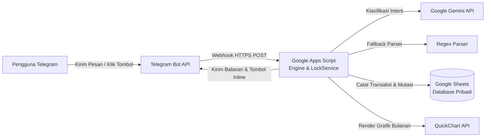

<div align="center">

# 👛 LedgerFlow
### *(Dompet Palsu Bot v2.1)*

**Personal Multi-Account Financial Ledger & Telegram Bot**  
*Didukung oleh Google Apps Script, Google Sheets, dan Google Gemini AI*

[-4285F4?logo=google&logoColor=white)](https://developers.google.com/apps-script)
[](https://ai.google.dev/)
[](https://core.telegram.org/bots)
[](tests/test_engine.js)
[](https://opensource.org/licenses/MIT)

<p align="center">
  <b>100% Serverless & Gratis</b> • <b>Data Milik Anda Sendiri (Private Google Sheets)</b> • <b>Pencatatan Bahasa Alami</b> • <b>Visualisasi Grafik Otomatis</b>
</p>

---

</div>

## 📌 Mengapa LedgerFlow?

Banyak aplikasi pengatur keuangan mengharuskan Anda membayar biaya langganan bulanan atau meminta akses ke akun bank Anda di server pihak ketiga. 

**LedgerFlow** hadir dengan pendekatan berbeda:
- 🔒 **Kedaulatan Data**: Basis data pembukuan Anda 100% tersimpan di Google Drive / Google Spreadsheet pribadi Anda. Tidak ada server perantara yang menampung data finansial Anda.
- ⚡ **Tanpa Biaya Server ($0/bulan)**: Berjalan langsung di atas infrastruktur Google Apps Script (GAS) gratis.
- 💬 **Antarmuka Chat Telegram**: Catat pengeluaran saat bepergian semudah mengirim pesan ke teman.
- 🧠 **Pemrosesan Bahasa Alami**: Memahami pesan seperti *"makan siang 25rb pakai tunai"* atau *"transfer bca ke gopay 100rb + admin 2500"* menggunakan Google Gemini AI dengan fallback parser regex lokal saat offline.
- ⚖️ **Sistem Ledger & Audit Trail Ketat**: Saldo dihitung murni dari riwayat mutasi transaksi (*Double-Entry principles*). Mendukung pembatalan transaksi (`/undo`), pengubahan nominal (`/edit`), serta koreksi fisik tanpa merusak riwayat transaksi lampau.

---

## ✨ Fitur Unggulan

| Fitur | Deskripsi |
| :--- | :--- |
| 🏦 **Multi-Akun & Saldo Awal** | Mendukung Tunai, BCA, Mandiri, BRI, BNI, BSI, Jago, SeaBank, GoPay, OVO, ShopeePay, DANA, dsb. Saldo dihitung sejak titik awal penetapan akun. |
| 🔄 **Pemisahan Biaya Admin Otomatis** | Pesan *"Tf BCA ke GoPay 100rb + admin 2500"* otomatis dipecah menjadi transaksi transfer pokok (100k) dan pengeluaran biaya admin (2.5k). |
| ⚠️ **Peringatan Saldo Kurang (Overdraft Guard)** | Jika saldo akun tercatat tidak mencukupi, bot tidak memindahkan akun diam-diam, melainkan menampilkan tombol konfirmasi interaktif. |
| ⚖️ **Koreksi Saldo Fisik** | Ketik *"Saldo tunai sebenarnya 420rb karena jajan pasar"*, bot akan menghitung selisih dan mencatat transaksi penyesuaian (*adjustment*) resmi. |
| 📊 **Grafik Tren & Evaluasi Bulanan** | Perintah `/bulan` menghasilkan grafik garis pengeluaran harian vs target budget dan diagram donat proporsi kategori via QuickChart API. |
| 🎭 **Persona Asisten Keuangan** | Pilihan persona respons AI: **Satir** (sarkas-humoris ala anak tongkrongan yang mengingatkan boncos) atau **Santai** (suportif, bijak, dan ramah). |

---

## 🛠️ Alur Arsitektur



---

## 📋 Skema Google Sheets

LedgerFlow mengelola 4 lembar kerja (*sheets*) yang dibuat otomatis atau manual:

```
┌─────────────────────────────────────────────────────────────┐
│                       GOOGLE SPREADSHEET                    │
├──────────────┬──────────────────────────────────────────────┤
│ Sheet        │ Kolom Utama                                  │
├──────────────┼──────────────────────────────────────────────┤
│ Users        │ Chat ID, Username, Nama, Daily Budget,       │
│              │ Persona, Created At, Default Akun            │
├──────────────┼──────────────────────────────────────────────┤
│ Akun         │ Chat ID, Nama Akun, Saldo Awal,              │
│              │ Tanggal Mulai Saldo, Updated At, Catatan     │
├──────────────┼──────────────────────────────────────────────┤
│ Transaksi    │ ID Transaksi, Timestamp, Chat ID, Tipe,      │
│              │ Akun, Akun Tujuan, Nominal, Kategori,        │
│              │ Item, Alasan, Pesan Asli, Status, User       │
├──────────────┼──────────────────────────────────────────────┤
│ Pengeluaran  │ TimeStamp, Chat ID, Nominal, Kategori,       │
│              │ Chat Asli, Chat Asli User, User,             │
│              │ ID Transaksi, Akun, Status                   │
└──────────────┴──────────────────────────────────────────────┘
```

---

## 🚀 Panduan Pemasangan Cepat

### 1. Buat Google Spreadsheet
1. Buka [Google Sheets](https://sheets.new) baru.
2. Beri nama spreadsheet Anda (misal: `Pembukuan LedgerFlow`).
3. Buat 4 sheet dengan nama: `Users`, `Akun`, `Transaksi`, dan `Pengeluaran`.

### 2. Salin Kode ke Google Apps Script
1. Di menu spreadsheet, klik **Ekstensi** > **Apps Script**.
2. Hapus kode bawaan, lalu salin seluruh isi berkas [`script.js`](script.js) ke dalam editor.
3. Buka **Project Settings** (ikon gerigi) > centang **"Show 'appsscript.json' manifest file in editor"**.
4. Salin isi berkas [`appsscript.json`](appsscript.json) ke editor manifest.

### 3. Konfigurasi Script Properties
Buka **Project Settings** > **Script Properties**, lalu tambahkan properti berikut:

| Properti | Nilai / Keterangan | Wajib? |
| :--- | :--- | :--- |
| `BOT_TOKEN` | Token bot Telegram dari [@BotFather](https://t.me/BotFather) | **Wajib** |
| `GEMINI_API_KEY` | API Key dari [Google AI Studio](https://aistudio.google.com/) | Opsional *(disarankan)* |
| `WEBAPP_URL` | URL deployment Web App Anda *(diisi setelah langkah 4)* | **Wajib** |
| `SPREADSHEET_ID` | ID spreadsheet *(hanya wajib jika script tidak terikat langsung ke sheet)* | Opsional |

*(Tips: Anda juga bisa menggunakan fungsi bantuan `setupScriptProperties()` di dalam skrip untuk mengisi nilai-nilai ini sekaligus).*

### 4. Deploy sebagai Web App
1. Klik tombol **Deploy** di pojok kanan atas > **New deployment**.
2. Pilih jenis deployment: **Web app**.
3. Konfigurasi:
   - **Execute as**: `Me (email Anda)`
   - **Who has access**: `Anyone` *(agar webhook Telegram dapat mengirimkan update)*
4. Klik **Deploy** dan berikan otorisasi izin akun Google Anda.
5. Salin **Web app URL** yang dihasilkan, lalu masukkan ke Script Properties `WEBAPP_URL`.

### 5. Pasang Webhook & Trigger Bulanan
1. Pada daftar fungsi di editor Apps Script, pilih fungsi `setWebhook` lalu klik **Run**.
2. Periksa log eksekusi untuk memastikan respon Telegram: `"ok": true`.
3. Pilih fungsi `pasangTriggerBulanan` lalu klik **Run** untuk mengaktifkan pengiriman rekap otomatis setiap tanggal 1 jam 08.00 pagi.

---

## 💬 Contoh Penggunaan di Telegram

```text
Pengguna : Saldo awal tunai 500rb
Bot      : 🏁 Titik Saldo Awal Ditetapkan!
           • Akun: Tunai (Rp500.000)

Pengguna : Makan nasi padang 25rb
Bot      : ✅ Tercatat Rp25.000 · Makanan
           📝 Item: nasi padang
           💳 Saldo tercatat Tunai: Rp475.000
           📊 🟢 Sisa budget harian: Rp75.000
           [↩️ Undo] [⭐ Jadikan Tunai Default]

Pengguna : Transfer BCA ke GoPay 100rb + admin 2500
Bot      : 🔄 Transfer Tercatat! (Rp100.000)
           📤 Dari BCA → 📥 Ke GoPay
           🧾 Biaya Admin (Pengeluaran): Rp2.500
           • Saldo BCA: Rp1.897.500
           • Saldo GoPay: Rp150.000

Pengguna : Saldo tunai sebenarnya 420rb
Bot      : ⚖️ Konfirmasi Koreksi Saldo Tunai
           • Tercatat: Rp475.000 | Sebenarnya: Rp420.000
           • Penyesuaian: -Rp55.000
           [✅ Konfirmasi Penyesuaian] [❌ Batal]
```

---

## 📖 Ringkasan Perintah Bot

| Perintah | Fungsi | Contoh Parameter |
| :--- | :--- | :--- |
| `/start` | Panduan awal & profil keuangan pengguna | `/start` |
| `/saldo` | Cek saldo tercatat seluruh akun & total | `/saldo` |
| `/setakun` | Atur akun pembayaran utama | `/setakun Tunai` atau `/setakun reset` |
| `/undo` | Batalkan transaksi terakhir / spesifik | `/undo` atau `/undo TRX-241122...` |
| `/edit` | Ubah nominal transaksi terakhir | `/edit 35rb` atau `/edit 35rb pakai BCA` |
| `/setbudget` | Ubah target batas anggaran harian | `/setbudget 150k` |
| `/setpersona` | Pilih gaya respons AI | `/setpersona satir` atau `/setpersona santai` |
| `/rekap` | Rekap transaksi pengeluaran hari ini | `/rekap` |
| `/bulan` | Grafik tren dan evaluasi bulanan | `/bulan` atau `/bulan 10-2026` |

---

## 🧪 Pengujian Unit Lokal

Mesin parsing, rumus saldo, sanitasi HTML, dan proteksi callback Telegram dapat diuji secara lokal menggunakan Node.js tanpa membutuhkan runtime browser:

```bash
# Menjalankan seluruh pengujian unit
npm test
```

Hasil uji:
- ✅ Normalisasi akun perbankan & e-wallet
- ✅ Parser nominal Indonesia (`rb`, `ribu`, `k`, `jt`, `juta`, koma/titik)
- ✅ Pemisahan otomatis pokok transfer dan biaya admin
- ✅ Ekstraksi intent deterministik & fallback regex kategori
- ✅ Jaminan panjang byte callback Telegram ($\le 64$ byte)
- ✅ Sanitasi karakter HTML / XSS prevention
- ✅ Formula aritmatika Saldo Tercatat:
  $$\text{Saldo} = \text{Saldo Awal} + \text{Pemasukan} - \text{Pengeluaran} + \text{Transfer Masuk} - \text{Transfer Keluar} \pm \text{Penyesuaian}$$

---

## 🛡️ Keamanan & Kredensial

1. **Jangan Pernah Mengunggah Token**: Berkas [`.gitignore`](.gitignore) telah dikonfigurasi untuk mengabaikan berkas cadangan lokal (`*.backup.js`), berkas `.env`, dan folder rahasia.
2. **Kunci API di Script Properties**: Jangan menuliskan token bot Telegram atau Gemini API Key di dalam badan kode. Selalu gunakan antarmuka *Script Properties* Google Apps Script.
3. **Rotasi Kredensial**: Jika token bot pernah terekspos ke publik atau ruang obrolan, segera buat token baru melalui `/revoke` di [@BotFather](https://t.me/BotFather).

---

## 📄 Lisensi

Didistribusikan di bawah Lisensi **MIT**. Siapa saja dipersilakan untuk memakai, memodifikasi, dan mengembangkan repositori ini untuk keperluan pribadi maupun komunitas.
